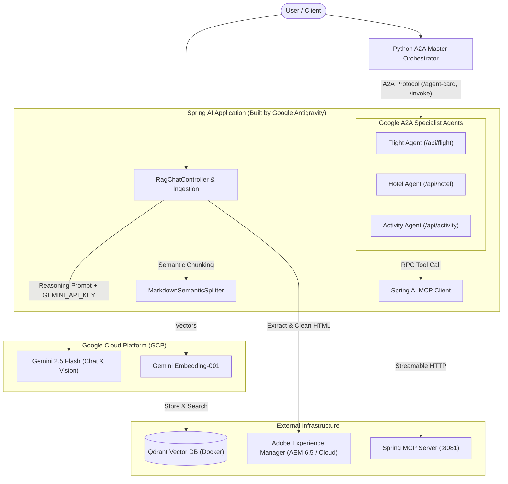

# aem-genai-architecture-showcase
Below is my private repository architecture documentation and architecture blueprint for the private AEM Gen AI codebase. Built with Google Antigravity, leveraging Google Cloud (GCP) and Gemini models. Features Google A2A multi-agent protocol, MCP tools, and Semantic Hybrid RAG with Qdrant.

# AEM Gen AI Integration

[](#built-with-google-antigravity)
[-EA4335?style=for-the-badge&logo=googlecloud&logoColor=white)](#google-cloud-platform--gemini-ai)
[](https://spring.io/projects/spring-boot)
[](https://spring.io/projects/spring-ai)
[](https://qdrant.tech/)

An enterprise-grade, agentic AI platform integrating **Adobe Experience Manager (AEM)** with modern generative AI capabilities. Powered by **Spring AI 2.0**, **Qdrant Vector DB**, and **Google Cloud Platform (GCP)** with **Google Gemini models**, this project delivers advanced Semantic Markdown Hybrid RAG, multi-modal asset ingestion, Model Context Protocol (MCP) tool exposure, and multi-agent coordination via the Google Agent-to-Agent (A2A) protocol.

---

## Highlights

### Built with Google Antigravity
This project was architected, engineered, and optimized using **Google Antigravity** — Google DeepMind's advanced agentic coding environment. From multi-modal pipelines and modular RAG architecture to dual-protocol agent communication (A2A + MCP), Antigravity steered the end-to-end design patterns and robust error handling.

### Google Cloud Platform & Gemini AI
At the core of this system is **Google Cloud Platform (GCP)** and Google's flagship **Gemini** foundational models:
- **Chat & Reasoning:** `gemini-2.5-flash` for high-speed, factual, and reasoning-driven dialogue.
- **Semantic Embeddings:** `gemini-embedding-001` (768 dimensions) for ultra-accurate vector representations.
- **Multimodal Vision:** Native Gemini vision API handling deep OCR and descriptive narration of complex DAM image assets.

> [!IMPORTANT]
> **Gemini API Key:**
> Access to Google GenAI capabilities is secured via the `GEMINI_API_KEY` environment variable. Never commit your private API keys. Use the included `.env.example` to configure your environment.

---

## Key Features

1. **Semantic Markdown Hybrid RAG (Retrieval-Augmented Generation)**
   - **Intelligent HTML-to-Markdown Ingestion:** Ingests live AEM pages via Jsoup, cleans noisy layout elements (`<nav>`, `<footer>`, `.cookie-banner`), and converts structured markup into GitHub Flavored Markdown using Flexmark.
   - **Two-Stage Chunking Strategy:**
     1. *Semantic Stage:* Slices documents strictly at heading boundaries (`#`, `##`, `###`) using `MarkdownSemanticSplitter` to keep tables, lists, and conceptual sections completely intact.
     2. *Token Fallback Stage:* `TokenTextSplitter` steps in only if a semantic chunk exceeds token limits (800 tokens max), preventing embedding and database overflow.
   - **Hallucination-Proof URL Citations:** Physical injection of source page paths into raw text chunks guarantees truthful attribution in LLM responses.

2. **Multimodal Image Ingestion & DAM Intelligence**
   - Ingests binary assets from AEM Digital Asset Management (DAM) across multiple formats (`.png`, `.jpg`, `.jpeg`, `.gif`, `.webp`).
   - Analyzes images with Gemini Vision using comprehensive prompts to generate detailed narrative descriptions and full OCR text extraction.
   - Embeds visual descriptions into Qdrant for semantic cross-modal search.

3. **Model Context Protocol (MCP) Server & Client**
   - Full support for Anthropic's **Model Context Protocol (MCP)** using Spring AI's WebFlux streamable HTTP transport.
   - Dual-annotated tool definitions (`@Tool` for local ChatClient and `@McpTool` for external MCP clients):
     - **Image Generation Tool:** Creates synthetic visual assets via Gemini.
     - **DAM Image Search Tool:** Discovers relevant images from the vector catalog.
     - **Image Save Tool:** Saves generated/modified assets directly to AEM DAM.
     - **Image Optimization Tool:** Compresses and resizes assets for web delivery.
     - **Weather Report Tool:** Demonstrates real-time external tool retrieval.

4. **Google Agent-to-Agent (A2A) Multi-Agent Architecture**
   - Implements Google's **Agent-to-Agent (A2A)** communication protocol.
   - Exposes specialist sub-agents with dedicated cards and invocation contracts:
     - `Flight Agent` (`/api/flight/agent-card`, `/api/flight/invoke`)
     - `Hotel Agent` (`/api/hotel/agent-card`, `/api/hotel/invoke`)
     - `Activity Agent` (`/api/activity/agent-card`, `/api/activity/invoke`)
   - Allows a master orchestrator (e.g. Python orchestrator) to discover agent capabilities dynamically and delegate multi-step reasoning plans.

5. **Production Dockerization**
   - Multi-stage Docker build utilizing Maven for compilation and Eclipse Temurin 21 JRE for an ultra-compact production container.
   - `docker-compose.yml` orchestrates Qdrant Vector Store with persistent storage volumes alongside the Spring AI service.

---

## Architecture Flow



---

## Tech Stack

| Layer | Technology |
|---|---|
| **AI Assistant / Builder** | **Google Antigravity** |
| **Cloud & AI Provider** | **Google Cloud Platform (GCP)** / Google AI |
| **LLM & Embeddings** | **Gemini 2.5 Flash**, **Gemini Embedding-001** |
| **Core Framework** | **Spring Boot 4.0.0**, **Spring AI 2.0.0 GA** |
| **Language** | **Java 21** |
| **Vector Database** | **Qdrant** (REST & gRPC via Docker) |
| **Protocols** | **Google A2A (Agent-to-Agent)**, **Model Context Protocol (MCP)** |
| **HTML & Markdown** | **Jsoup**, **Flexmark Java** |
| **Containerization** | **Docker**, **Docker Compose** |

---

## Getting Started

### Prerequisites
- **Java 21** (JDK 21 or higher)
- **Docker Desktop** (with WSL 2 on Windows)
- **Maven 3.9+** (or use the included `./mvnw`)
- **Google Gemini API Key** ([Get a key from Google AI Studio](https://aistudio.google.com/))
- *(Optional)* Local Adobe Experience Manager (AEM) instance running on port `4502`

---

### 1. Configure Environment Variables

Copy the provided [`.env.example`](file:///.env.example) template to `.env` or set the variable in your terminal:

```bash
# Windows PowerShell
$env:GEMINI_API_KEY="AIzaSyYourActualGeminiApiKey"

# Linux / macOS
export GEMINI_API_KEY="AIzaSyYourActualGeminiApiKey"
```

---

### 2. Run with Docker Compose (Recommended)

To start both Qdrant Vector Store and the Spring AI application in Docker:

```bash
docker-compose up -d --build
```

- **Spring AI Application:** `http://localhost:8080`
- **Qdrant Dashboard & REST:** `http://localhost:6333`
- **Qdrant gRPC:** `localhost:6334`

To run **only** Qdrant in Docker (if you prefer running Spring Boot locally):

```bash
docker-compose up -d qdrant
```

---

### 3. Run Spring Boot Locally

```bash
# Windows
.\mvnw.cmd clean spring-boot:run

# Linux / macOS
./mvnw clean spring-boot:run
```

---

## API Endpoints Overview

### RAG & Chat
- `GET /api/chat/ask?question={query}&conversationId={id}`: Ask a contextual question answered against ingested AEM knowledge with verified page citations.
- `POST /api/ingest/page?path={aemPath}`: Trigger HTML extraction, semantic markdown chunking, and embedding into Qdrant.

### Google A2A Specialist Agents
- `GET /api/flight/agent-card`: Discover Flight Agent metadata and input schema.
- `POST /api/flight/invoke`: Delegate flight planning and booking tasks.
- `GET /api/hotel/agent-card`: Discover Hotel Agent metadata and input schema.
- `POST /api/hotel/invoke`: Delegate hotel search and accommodation tasks.
- `GET /api/activity/agent-card`: Discover Activity Agent metadata and input schema.
- `POST /api/activity/invoke`: Delegate excursion booking tasks.

---

## Security & Best Practices

- **Zero Hardcoded Secrets:** No API keys, credentials, or private tokens are stored in source control.
- **Environment Isolation:** Sensitive values are read exclusively from environment variables (`GEMINI_API_KEY`).
- **Git Hygiene:** Unwanted artifacts, virtual environments, and runtime logs are excluded via `.gitignore`. Refer to [`.env.example`](file:///.env.example) for setup guidance.

---

## Acknowledgments
Built with 💙 by **Google Antigravity** using **Google Cloud Platform** and **Spring AI**.

